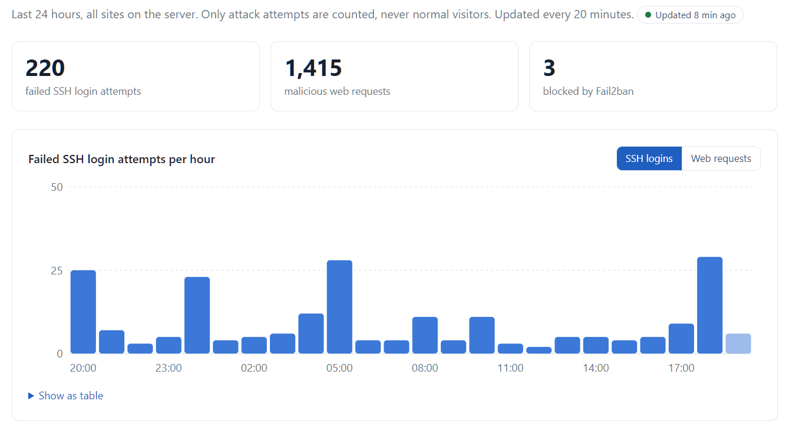

# Hardened Web Server

A public Ubuntu 24.04 VPS running Nginx, hardened from the firewall to the kernel and watched through its own logs.
It serves my lab page, which shows **live attack data from this server, updated every 20 minutes**:

**Live page:** https://dvir-lab.duckdns.org



> This is project 2 of my portfolio. Project 1 is a [Home SOC Lab](https://github.com/Dvir-Dadon/home-soc-lab)
> (Active Directory + Wazuh SIEM, Tier 1 incident report). The two projects are separate.

## Why this project

A home lab is controlled. A public server is not: within hours of going online it gets SSH brute-force
attempts, `.env` and `.aws/credentials` hunting, WordPress probes on a site that has no WordPress, and internet-wide
scanners such as Censys. I wanted to harden a real internet-facing server, measure what hits it, and investigate
anything that looked wrong, the way a SOC analyst would.

## Architecture

```
Internet ──► ufw (22, 80, 443 only)
              │
              ├─► sshd (keys only)  ──► journal ─┐
              │                                  ├─► Fail2ban (bans)
              └─► Nginx (TLS 1.2/1.3)            │
                   ├─ dvir-lab.duckdns.org  → /var/www/lab   (this lab page)
                   ├─ family recipe site    → /var/www/html  (static, not linked)
                   └─ catch-all             → 444 / TLS handshake rejected
                         │
                         └─► access.log ─────────┴─► lab-stats (cron, every 20 min)
                                                      → attack counts → dashboard
```

Administration is done only from a dedicated Ubuntu VM that holds the SSH key. A separate Kali VM is used
to test the server from the outside.

## Hardening in place

| Area | Control | Why |
|---|---|---|
| Network | `ufw`: only 22, 80, 443 open | Nothing else is reachable, even if a service starts by mistake |
| SSH | Keys only, `PermitRootLogin no`, admin via non-root sudo user | Password brute force becomes pointless; the most attacked account cannot log in |
| SSH | `MaxAuthTries 3`, no X11 / agent / TCP forwarding, `LogLevel VERBOSE`, legal banner | Fewer guesses per connection, no tunnelling through the server, better logs for investigation |
| SSH + web | Fail2ban jails `sshd` and `nginx-botsearch` | Cuts noise and blocks repeat scanners at the firewall |
| TLS | TLS 1.2/1.3 only, Let's Encrypt per site with auto-renew, HSTS | No legacy protocols, no downgrade to HTTP |
| Headers | Strict CSP (no inline code) + security headers, set once at `http` level, `server_tokens off` | Limits XSS and clickjacking; hides the server version |
| Nginx | Catch-all server: unknown name / bare IP → `444`, TLS handshake rejected | Scanners hitting the IP get nothing, not even a certificate with the site names |
| Nginx | `snippets/block-sensitive.conf`: hidden, backup and secret files blocked | `.env`, `.git` and similar can never be served by mistake |
| Kernel | `sysctl` hardening; dccp, sctp, rds, tipc, usb-storage modules blocked; no core dumps; compilers root-only | Smaller attack surface on the OS itself |
| Audit | `auditd`, `sysstat`, process accounting (`acct`) | A record to investigate from if something does happen |
| Updates | `unattended-upgrades`, automatic reboot at 02:00 UTC when needed, old kernels removed; certbot renews itself | Patched without waiting for me |
| Checks | `scripts/security-check.sh`: logins, failures, bans, scans, backdoor indicators, updates | One command to re-verify the server |
| Monitoring | Weekly manual review of the dashboard and `security-check.sh` output | Catches a stalled pipeline or a new attack pattern |

The exported, redacted configuration files are in [`configs/`](configs/).

## Lynis: 60 → 78

| | Hardening index |
|---|---|
| Before | 60 |
| After | 78 |

Not fixed, on purpose:

| Lynis suggestion | Why it stays |
|---|---|
| Separate partitions | Single-disk VPS; repartitioning a live system is risky for little gain here |
| GRUB password | The boot console is only reachable through the hosting panel, so the panel account is what needs protecting |
| Password policy | No account can log in with a password at all |
| Move SSH off port 22 | Hiding, not protection, and it would remove the attack data the dashboard shows |
| Malware scanner | Static sites, no uploads or server-side code; auditd and the check script watch for changes |

## Live attack data

`bin/lab-stats.py` runs every 20 minutes from `/etc/cron.d/lab-stats` (Python standard library only) and writes
`data/stats.json`, which the lab page renders. There is no backend: the page is static.

The page shows **only the attack attempts and what was tried**:

- **How many:** failed SSH logins, malicious web requests and Fail2ban blocks, per hour, per day and for the last 24 h.
- **What:** the usernames bots tried, the paths scanners looked for, and the type of each web attack
  (secret hunting, admin panels, WordPress, traversal, bare-IP requests dropped by the catch-all, and so on).

How it is counted:

- **SSH:** `journalctl -u ssh`, with the same rule as `security-check.sh` (`Invalid user`, `authenticating user`,
  `Failed`). Successful logins are skipped by matching `^Accepted ` at the start of the message, not anywhere in the
  line (see incident 1).
- **Web:** only attack events: scanner paths, unusual methods (`TRACE`), bare-IP requests dropped with `444`, and
  other 400/404s. Normal visitors are dropped while the log is read and are never counted or stored.
- **History:** 30 days of hourly counts in `/var/lib/lab-stats/`, merged with `max()` so a reboot or log rotation can
  add information but never erase it.

Privacy and safety by design:

- **No IP address is published or stored, not even in part.** IPs exist only in memory during a run, to exclude my
  own traffic and for the check below. IPs that appear inside usernames or paths are replaced by `x.x.x.x`.
- Usernames and paths come from attackers. They are character-filtered and length-limited, and one is listed only
  when at least 3 different sources sent it, so a single attacker cannot write words of his choice onto the page.
  The page inserts them with `textContent` only, never `innerHTML`, and the CSP blocks inline script.
- Real account names (UID ≥ 1000) are never listed.
- The collector runs as root, so it never runs a shell: external commands get fixed argument lists, config files
  are read as data, and logs are streamed line by line. The JSON is written atomically under a lock.
- The installer refuses to install if its read-only test run finds an IP, the home network or a key fingerprint in
  the output, and `--check` prints the exact JSON that would go public.

## Incidents I investigated

| # | Alert | Verdict | Write-up |
|---|---|---|---|
| 1 | "Successful SSH login" every hour | False positive: `grep Accepted` matched `PubkeyAcceptedAlgorithms` | [docs/incidents/01-ssh-login-false-positive.md](docs/incidents/01-ssh-login-false-positive.md) |
| 2 | File with a modification time in the future | Benign: `wget` copies `Last-Modified` into mtime. Ruled out timestomping with ctime | [docs/incidents/02-future-timestamp.md](docs/incidents/02-future-timestamp.md) |

## Verify it yourself

- Security Headers: https://securityheaders.com/?q=dvir-lab.duckdns.org&followRedirects=on
- SSL Labs: https://www.ssllabs.com/ssltest/analyze.html?d=dvir-lab.duckdns.org&hideResults=on
- Mozilla Observatory: https://developer.mozilla.org/en-US/observatory/analyze?host=dvir-lab.duckdns.org

Checks I run from an external Kali VM: HTTP → HTTPS (301), 6/6 security headers, server version hidden,
`/.git` and `/.env` → 404, directory listing → 403, bare IP → connection dropped, `TRACE` → 405,
SSH with a password → refused. Active scanning (port scans, Nikto) is on hold until the hosting provider approves
it in writing, as its acceptable-use policy requires.

Screenshots are in [`docs/screenshots/`](docs/screenshots/).

## Repository layout

```
bin/lab-stats.py           log summarizer (stdlib Python), every 20 minutes
conf/                      /etc/lab-stats.conf and the cron entry
site/                      the lab page: static HTML, CSS, JS (CSP-safe, no inline code)
install.sh                 deploy: --check (read-only preflight), backup, install, --uninstall
tools/redact.sh            masks home IP, user name, key fingerprints in terminal output (for screenshots)
tools/export-configs.sh    exports redacted configs from the server (only files I added, not distro defaults)
tools/prep-screens.sh      strips metadata from screenshots and OCR-scans them for leaks
tools/pre-publish-check.sh blocks a push if personal data is found
configs/                   redacted configuration from the live server, incl. security-check.sh
docs/                      incident write-ups and screenshots
```

Deploy (on the server): `sudo ./install.sh --check`, then `sudo ./install.sh`.

## What I would add next

- A Telegram alert on every SSH login
- Automatic reports to AbuseIPDB
- Infrastructure as code (Ansible) so the whole hardening is reproducible

## Lessons learned

- A detection rule is only as good as its pattern: test it against raw events before trusting it.
- Know which evidence an attacker can forge (mtime) and which they cannot easily forge (ctime).
- Anything that comes from a log is attacker input. Treat it as untrusted when you display it.
- A security score is a checklist, not a goal. Each item is weighed against the real risk.
